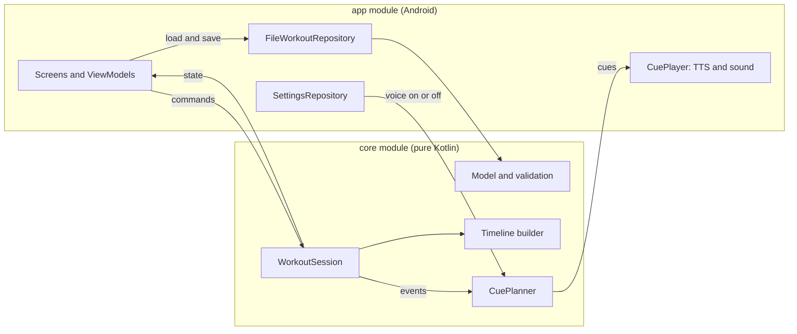
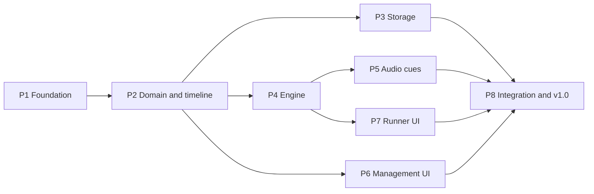

# Workout Timer — Implementation Plan

| | |
|---|---|
| **Status** | Draft v0.2, review applied |
| **Last updated** | 2026-11-02 |
| **Based on** | [SPECIFICATION.md](SPECIFICATION.md) v0.5 |

[SPECIFICATION.md](SPECIFICATION.md) says *what* the app does. This plan says *how* it is built: the architecture, the technical decisions, and the phases of work. Each phase gets its own specification and handover documents (see [§6](#6-working-method)).

How to read it:

- IDs are used the same way as in the specification, so each item can be accepted, changed or discarded on its own:
  - `D-n`: technical decisions
  - `P1`–`P8`: phases
  - `SK-n`: proposed Claude Code skills
  - `PQ-n`: open questions about the plan
- Requirement IDs such as `EX-4` or `NF-1` refer to [SPECIFICATION.md](SPECIFICATION.md).

---

## Contents

1. [Tech stack](#1-tech-stack)
2. [Architecture](#2-architecture)
3. [Security and privacy](#3-security-and-privacy)
4. [Testing strategy](#4-testing-strategy)
5. [Phases](#5-phases)
6. [Working method](#6-working-method)
7. [Claude Code skills and context](#7-claude-code-skills-and-context)
8. [Open questions](#8-open-questions)
9. [Change log](#9-change-log)

---

## 1. Tech stack

| Area | Choice |
|---|---|
| Language | Kotlin |
| UI | Jetpack Compose with Material 3, single activity |
| Build | Gradle (Kotlin DSL) with a version catalog. Android Studio 2026.1 and Gradle 9.x are already installed. |
| SDK levels | `minSdk` 26 (Android 8.0). Compile and target SDK: the latest stable level installed, pinned in P1. |
| Modules | `:core` (pure Kotlin, no Android) and `:app` (Android) |
| Storage | Workouts as JSON files (kotlinx.serialization); settings in Jetpack DataStore |
| Audio | Android `TextToSpeech` with the English (United States) voice; a bundled round-end sound |
| Dependency injection | Manual, through one `AppContainer` class |
| Tests | JUnit, kotlinx-coroutines-test, Compose UI tests on the tablet |
| CI | GitHub Actions: build, unit tests, lint |

### 1.1 Technical decisions

| ID | Decision | Reason |
|---|---|---|
| D-1 | Kotlin and Jetpack Compose (Material 3), single activity. | The standard modern Android stack. Compose runs on API 26. |
| D-2 | Two Gradle modules: `:core` holds the model, timeline, engine and cue logic in pure Kotlin. `:app` holds everything that needs Android. | The timing and cue logic is the heart of the app and most of its risk. On the JVM it can be tested in seconds, and Android code can't leak into it. |
| D-3 | Manual dependency injection through an `AppContainer`. | The app has few dependencies. A framework such as Hilt adds build complexity with no real gain at this size. |
| D-4 | Each workout is stored as one JSON file (kotlinx.serialization), written atomically. | A workout is edited and saved as a whole. Files are simple to test, easy to inspect with `adb`, and easy to back up later. Room (SQLite) was considered: it needs more code for a nested structure, and there are no queries to justify it. |
| D-5 | Settings are stored in Jetpack DataStore (Preferences). | The standard key-value storage. There is one setting today (`TTS-9`). |
| D-6 | Time comes from a monotonic clock (`SystemClock.elapsedRealtime`) behind a `Clock` interface. Phase boundaries are computed from absolute times, not by counting ticks. | Meets `NF-1`. It ignores changes to the wall-clock time, and tests can use a fake clock. |
| D-7 | The engine is a pure state machine. It exposes its state as a `StateFlow` and its events as a `Flow`. The runner screen's ViewModel owns it. | The screen and the audio react to the same source. The ViewModel survives configuration changes (`NF-3`). |
| D-8 | No background service. The workout pauses when the activity stops. | Implements `EX-10`. It also avoids EMUI killing background work. |
| D-9 | The platform `TextToSpeech`, set to `Locale.US`. Utterance callbacks drive the get-ready countdown. | Implements `TTS-10` and `TTS-11` without extra libraries. |
| D-10 | The round-end sound is a short chime generated by a script in the repo. | A public repo shouldn't raise questions about third-party audio licences. |
| D-11 | Android Auto Backup is disabled (`allowBackup="false"`). | `NF-4`: workout data never leaves the device. |
| D-12 | Versions: the latest stable releases that work with the installed Android Studio 2026.1.3, which supports AGP up to 9.3. All are pinned in the version catalog during P1. | Reproducible builds that open in the installed IDE. Upgrades are deliberate. |
| D-13 | Each UI feature keeps its text in its own resource file (`strings_<feature>.xml`). | `NF-9` asks for translatable text. Separate files also avoid merge conflicts when phases run in parallel. |

## 2. Architecture

### 2.1 Modules and packages

```
workout-timer/
├── core/              pure Kotlin (JVM), no Android dependencies
│   ├── model/         Workout, Round, Exercise; default resolution; validation
│   ├── timeline/      turns a workout into the ordered list of phases; totals; next/previous targets
│   ├── engine/        WorkoutSession state machine; Clock
│   └── cues/          CuePlanner: decides what to say or play, and when
└── app/               Android application
    ├── data/          file-based WorkoutRepository; SettingsRepository (DataStore)
    ├── audio/         TTS speaker, sound player, cue player
    ├── ui/            theme and screens: list, editor, settings, runner, completed
    ├── navigation/    navigation host and routes
    └── di/            AppContainer
```

### 2.2 Components



### 2.3 How a workout runs

1. The runner ViewModel loads the workout and builds its **timeline**. The timeline is the flat, ordered list of phases (get ready, exercises, rests), each with its duration and the round and exercise it belongs to. All the rules in spec §4.3 are applied here, once.
2. A **`WorkoutSession`** walks the timeline:
   - It keeps the current phase, the clock time when that phase started, and whether it is paused.
   - Remaining time is always computed as *phase duration − time elapsed in the phase*.
   - A coroutine wakes at each whole-second boundary, and also on every command.
3. When a phase ends, the next one starts at the **exact end time** of the previous one, not at the time of the tick that noticed it. Late ticks never shift the schedule (`NF-1`).
4. The session publishes two things:
   - a **state** for the screen: phase, names, remaining time, progress, paused;
   - **events** for the audio: phase started, second changed, paused, resumed, round ended, completed, stopped.
5. The **`CuePlanner`** turns events into cues, such as *speak "Squats"*, *play the round-end sound* or *stop speaking*. It applies `TTS-1`–`TTS-12`, `SND-1`, `SND-2` and the voice setting. Because it is pure Kotlin, a test can check the whole cue sequence of a workout.
6. The **`CuePlayer`** plays the cues in order. If the round-end sound and an exercise name fall at the same moment, the sound plays first (`SND-1`). Pausing stops speech (`TTS-3`).
7. **Get ready** (`TTS-10`) is the one place where audio drives the timer:
   - the session waits in the get-ready phase while "Get ready in" is spoken;
   - the player reports when the speech ends, and the 3 s countdown starts;
   - if voice cues are off, the countdown starts immediately;
   - a timeout keeps the workout from getting stuck if TTS fails.

The ViewModel owns the session, so rotating between the two landscape orientations doesn't affect it (`NF-3`). The runner screen keeps the display on (`NF-2`) and pauses the session when the activity stops (`EX-10`).

### 2.4 Storage

- Each workout is stored as `workouts/<id>.json` in the app's private storage.
- Writes go to a temporary file first, which is then moved into place, so a crash never leaves a half-written workout.
- The file format has a `schemaVersion` field, so it can change later without losing data.
- The `WorkoutRepository` interface lives in `:core` (P2), with an in-memory fake for tests and for phases that run before P3 is merged.
- Settings (voice cues on/off) are stored in DataStore.

## 3. Security and privacy

The app handles no personal or sensitive data, but it should stay small and closed:

- **No network.** The manifest has no `INTERNET` permission. CI fails if the merged manifest gains it, for example through a library (`NF-4`).
- **No backup to the cloud.** Auto Backup is disabled (`D-11`).
- **Private storage only.** Workouts live in app-private storage, so other apps can't read them.
- **Minimal surface.** Only the launcher activity is exported. There are no services, receivers or content providers.
- **Signing keys stay out of the repo.** The release keystore and its passwords live outside the repository, in user-level Gradle properties. `.gitignore` already excludes keystore files.
- **Trusted dependencies.**
  - Only well-known AndroidX, JetBrains and Google libraries, from Google Maven and Maven Central.
  - The Gradle wrapper is pinned with a checksum and validated in CI.
  - GitHub Actions are pinned to commit SHAs, and CI runs with read-only permissions.
- **Debug-only logging.** Release builds don't log.

## 4. Testing strategy

| Level | What | Where | Tools |
|---|---|---|---|
| Unit (JVM) | Model, validation, timeline, engine, cue planner | `:core` | JUnit, kotlinx-coroutines-test with virtual time, a fake `Clock` |
| Unit (JVM) | Repository (JSON round-trip, atomic writes, damaged files), ViewModels | `:app` unit tests | JUnit, temporary folders, fakes |
| UI (instrumented) | Key flows: create and edit a workout, run and pause, stop with confirmation | The tablet | Compose UI tests |
| Manual | Cue timing by ear, readability from 3 m, a real 60-minute accuracy run | The tablet | A checklist in each phase's handover |

Rules:

- Each phase spec says which test or manual check covers each requirement it implements.
- CI runs the build, unit tests and lint on every push and pull request.
- Instrumented tests run locally against the tablet (`connectedDebugAndroidTest`). CI has no device.

## 5. Phases

### 5.1 Overview

| Phase | Name | Depends on | Status |
|---|---|---|---|
| P1 | Project foundation | — | Done |
| P2 | Domain model and timeline | P1 | Planned |
| P3 | Storage | P2 | Planned |
| P4 | Workout engine | P2 | Planned |
| P5 | Audio cues | P4 | Planned |
| P6 | Workout management UI | P2 | Planned |
| P7 | Workout runner UI | P4 | Planned |
| P8 | Integration and v1.0 | P3, P5, P6, P7 | Planned |



**Running phases in parallel:**

- After P2, phases **P3, P4 and P6** can run in parallel.
- After P4, phases **P5 and P7** can run in parallel.
- The critical path is P1 → P2 → P4 → P5 / P7 → P8.

**Rules that make parallel work safe:**

- **Package ownership.** Each phase owns the packages and resource files listed in its spec. Shared files (Gradle files, `AppContainer`, the navigation host) are created in P1 with a slot for every feature. Later phases only fill in their own slot.
- **Interfaces and fakes.** Phases code against interfaces from P2 (`WorkoutRepository`) and P4 (session state and events).
- **Pending wiring.** If the phase that provides a real implementation is already merged, wire it in. If not, use the fake and list the missing connection under "Pending wiring" in the handover. P8 completes it.
- **Branches.** Each phase works on its own branch, in its own git worktree when phases run in parallel (§6.3).

### 5.2 Phase details

The summaries below are the source for each phase's own SPEC.md, which expands them (§6.1).

#### P1 — Project foundation

- **Goal:** an empty but complete app skeleton that builds, tests and installs on the tablet, with CI.
- **Covers:**
  - `NF-4`, `NF-5`, `NF-7`, `NF-8`;
  - the foundations for `NF-6` (theme) and `NF-9` (text in resources).
- **Scope:**
  - **Gradle setup:** the version catalog, the `:core` and `:app` modules, and the Gradle wrapper with checksum. Versions are pinned (`D-12`).
  - **App skeleton:** a single activity locked to landscape (both directions), a Material 3 theme with the phase colours, the navigation host with placeholder screens for all five screens, and the `AppContainer`.
  - **Manifest:** no `INTERNET` permission, Auto Backup disabled, only the launcher activity exported.
  - **Code style:** a Kotlin style check (ktlint).
  - **GitHub Actions:**
    - build, unit tests and lint;
    - Gradle wrapper validation;
    - a check that the merged manifest has no `INTERNET` permission.
  - **CLAUDE.md:** the project guide for Claude Code sessions (see §7).
- **Done when:**
  - `gradlew build` passes locally and in CI;
  - `gradlew installDebug` installs the app on the tablet;
  - the app opens in landscape and moves between the placeholder screens.

#### P2 — Domain model and timeline

- **Goal:** the workout model, and the pure logic that turns a workout into its sequence of phases.
- **Covers:**
  - workout rules: `WM-1`, `WM-2`, `WM-6` (total duration), `WM-7` (validation rules);
  - execution rules: `EX-1`, `EX-3`, `EX-7` (get-ready phase), `EX-9` (next and previous targets);
  - spec §4.2 (linked defaults, unused values) and §4.3 (sequencing rules).
- **Scope:**
  - **Model:** `Workout`, `Round` and `Exercise`, with resolution of effective durations and rests, and validation that returns a list of errors.
  - **Timeline:** the timeline builder, the total duration, and the next/previous targets.
  - **Storage interface:** the `WorkoutRepository` interface and an in-memory fake.
- **Done when:** unit tests cover every rule in §4.3 and the next/previous table in §5.1. The §4.4 example also has a test: it must give the same phases and a total of 4:23.

#### P3 — Storage

- **Goal:** store workouts and settings on the device.
- **Covers:** `WM-3`, `WM-4` (storage operations), `WM-8`, and storing the `TTS-9` setting.
- **Scope:**
  - **JSON format:** version 1, with `schemaVersion`.
  - **`FileWorkoutRepository`:** one file per workout, atomic writes. A damaged file is skipped and logged, never fatal.
  - **`SettingsRepository`:** settings stored in DataStore.
- **Done when:**
  - tests cover a save-and-load round trip, atomic writes and damaged files;
  - on the tablet, workouts survive closing the app and rebooting.

#### P4 — Workout engine

- **Goal:** the state machine that runs a timeline in real time.
- **Covers:**
  - the execution logic of `EX-2`, `EX-4`, `EX-5`, `EX-6`, `EX-8` and `EX-9`;
  - `NF-1` (accuracy);
  - the get-ready handshake needed by `TTS-10`.
- **Scope:**
  - **Clock:** the `Clock` interface and a fake for tests.
  - **`WorkoutSession` commands:** start, pause, resume, next, previous, stop, and "announcement finished".
  - **Outputs:** the session state and the event types.
- **Done when:** tests cover:
  - every transition in spec §4.3 and the next/previous table;
  - pausing and resuming at any moment;
  - a simulated 60-minute workout with randomly late ticks that still ends exactly on schedule.

#### P5 — Audio cues

- **Goal:** the voice and sound cues.
- **Covers:** `TTS-1`, `TTS-2`, `TTS-3`, `TTS-4`, `TTS-7`, `TTS-9` (applying the setting), `TTS-10`, `TTS-11`, `TTS-12`, `SND-1`, `SND-2`.
- **Scope:**
  - **`CuePlanner`** (in `:core`): tests check the full cue sequence of the §4.4 example.
  - **TTS speaker:** `TextToSpeech` set to `Locale.US`, with a readiness check and utterance callbacks.
  - **Sound player:** plays the round-end chime, generated by a script (`D-10`).
  - **`CuePlayer`:** orders the cues and stops speech on pause.
  - **Debug screen:** a debug-only screen that runs a workout with audio and no UI, so cues can be checked by ear before P7 exists.
- **Done when:**
  - the planner tests pass;
  - on the tablet, still set to Spanish, every cue is heard in English at the right moment.

#### P6 — Workout management UI

- **Goal:** the screens to create, edit and organise workouts, and the settings screen.
- **Covers:** the UI side of `WM-1` to `WM-8`, the confirmations in `WM-9` and `WM-10`, the `TTS-9` settings screen, `NF-6` and `NF-9`.
- **Scope:**
  - **Workout list:** name, total duration, start, edit, duplicate, delete with confirmation, new workout, and the way to settings.
  - **Workout editor:**
    - the workout's name and defaults;
    - adding, renaming, reordering, duplicating and removing rounds and exercises;
    - own durations and rests that show the default when not set;
    - unused rest fields marked as not applicable;
    - validation messages;
    - a confirmation before discarding unsaved changes.
  - **Settings screen:** voice cues on/off.
- **Done when:**
  - Compose UI tests cover creating, editing and validating a workout;
  - a manual check on the tablet passes.

#### P7 — Workout runner UI

- **Goal:** the runner and completed screens.
- **Covers:**
  - `UI-1`–`UI-7`, `UI-10` and `UI-11`;
  - the UI side of `EX-4` to `EX-11`;
  - `NF-2`, `NF-3` and `NF-6`.
- **Scope:**
  - **Runner ViewModel:** owns the session.
  - **Runner screen states:** get ready, exercise, rest and paused, each with its colour.
  - **Paused controls:** Resume, Previous, Next and Stop, with confirmation for Stop.
  - **Completed screen.**
  - **Screen and lifecycle:**
    - keep the screen on;
    - pause when the activity stops;
    - after Android closes the app, it may rebuild the navigation stack. The runner then has no live session, so it returns to the workout list (`EX-11`).
- **Done when:**
  - UI tests cover pause, resume, next, previous and stop;
  - on the tablet, the screen is readable from 3 m, and flipping between landscape orientations keeps the state.

#### P8 — Integration and v1.0

- **Goal:** everything wired together, accepted on the tablet, and released.
- **Covers:** every requirement, with final checks of `NF-1` (a real 60-minute run), `NF-3`, `NF-4`, `NF-5` and `NF-7`.
- **Scope:**
  - **Wiring:** finish any pending wiring (real repository, audio in the runner, settings).
  - **End-to-end test:** one UI test that creates a workout, runs it and completes it.
  - **Acceptance:** a manual checklist on the tablet against every requirement ID.
  - **Release:** a release build signed with your own keystore (kept outside the repo), the `v1.0.0` tag, and a GitHub release with the APK attached.
- **Done when:** every item in the acceptance checklist passes, and `v1.0.0` is tagged.

### 5.3 Requirement coverage

Every requirement in the specification is assigned to at least one phase.

| Requirements | Phases |
|---|---|
| `EX-1`, `EX-3` | P2 (rules), P4 (execution) |
| `EX-2`, `EX-5` | P4 |
| `EX-4`, `EX-6`, `EX-8` | P4 (logic), P7 (UI) |
| `EX-7` | P2 (phase), P4 (handshake), P5 (voice), P7 (display) |
| `EX-9` | P2 (targets), P4 (logic), P7 (UI) |
| `EX-10`, `EX-11` | P7 |
| `UI-1`–`UI-7`, `UI-10`, `UI-11` | P7 |
| `TTS-1`–`TTS-4`, `TTS-7`, `TTS-10`–`TTS-12`, `SND-1`, `SND-2` | P5 |
| `TTS-9` | P3 (stored), P5 (applied), P6 (settings screen) |
| `WM-1`, `WM-2`, `WM-6`, `WM-7` | P2 (rules), P6 (UI) |
| `WM-3`, `WM-4` | P3 (storage), P6 (UI) |
| `WM-5`, `WM-9`, `WM-10` | P6 |
| `WM-8` | P3 |
| `NF-1` | P4, verified in P8 |
| `NF-2` | P7 |
| `NF-3` | P7, verified in P8 |
| `NF-4`, `NF-5`, `NF-7` | P1, verified in P8 |
| `NF-6` | P1 (theme), P6, P7 |
| `NF-8` | P1 |
| `NF-9` | P1 (convention), P6, P7 |

## 6. Working method

### 6.1 Phase documents

Each phase has a folder `docs/phases/PN-<name>/` with two documents. Templates are in [docs/phases/_templates/](phases/_templates/).

| Document | Purpose | When it's written |
|---|---|---|
| **SPEC.md** | The goal of the phase and everything needed to implement it: the requirements it covers (with their text quoted), design, security, tests, tasks and done criteria. It starts from the summary in §5.2 and expands it. | Before the phase starts, once its dependencies are stable. It is reviewed like the main specification. |
| **HANDOVER.md** | Tracks the phase as it is built: status, next steps, task progress, decisions and deviations, known issues, pending wiring, how to verify, and a session log. | Updated at the end of every working session, so the next session can continue without re-reading everything. |

**Self-contained:** a phase SPEC.md quotes the requirement text it implements. Working on a phase then only needs CLAUDE.md plus that phase's SPEC.md and HANDOVER.md, not the whole specification and plan.

**Precedence:** SPECIFICATION.md, then this plan, then the phase SPEC.md. If a phase finds a problem in a higher document, that document is fixed first (with a new version), then the change flows down.

### 6.2 Phase lifecycle

| Status | Meaning |
|---|---|
| Planned | Listed in this plan only |
| Spec draft | SPEC.md written and under review |
| Ready | SPEC.md agreed, and its dependencies are done |
| In progress | Being implemented; HANDOVER.md is updated every session |
| Done | Done criteria met and merged into `main` |

The status column in §5.1 is updated whenever a phase changes status. Status changes are committed straight to `main` and don't need a new plan version. Committing them on phase branches would cause merge conflicts between parallel phases.

### 6.3 Git workflow

- `main` always builds and passes CI.
- Each phase is built on its own branch, `phase/pN-<name>`. Phases running in parallel use separate git worktrees.
- A phase is merged into `main` through a pull request once its done criteria pass. The pull request links to the phase documents.
- Document drafts (specification, plan, phase SPEC.md files) are committed and pushed to `main` at each version, as so far.

### 6.4 Session routine

1. **Start:** read the phase's HANDOVER.md and carry on from "Next steps".
2. **Work:** follow the phase SPEC.md. Record any decision or deviation in the handover as it happens.
3. **End:** update the handover, run the checks, then commit and push.

Skills `SK-2` and `SK-3` (§7) automate the start and the end.

## 7. Claude Code skills and context

The biggest context saver is a good **CLAUDE.md** at the repo root, created in P1. Claude Code loads it automatically in every session. It will hold:

- a short project overview, and the module and package boundaries;
- the build, test and install commands;
- the documentation workflow from §6;
- coding conventions.

Skills complement it. They are repeatable procedures, loaded only when used. They live in `.claude/skills/` inside the repo, so they are versioned and available in every session.

| ID | Skill | What it does | What it saves |
|---|---|---|---|
| SK-1 | `phase-docs` | Creates a phase's SPEC.md and HANDOVER.md from §5.2 and the templates. It quotes the text of each covered requirement from the specification. | Time, and consistent documents across the eight phases |
| SK-2 | `phase-start` | Loads only the phase's SPEC.md and HANDOVER.md, checks that its dependencies are done, creates the branch (or worktree), and marks the phase as in progress. | Context: a session never needs to read the full specification and plan |
| SK-3 | `handover` | At the end of a session: runs the checks, updates the handover (log, tasks, next steps, deviations), and commits and pushes. | Continuity between sessions; nothing is forgotten |
| SK-4 | `tablet` | Builds, installs and launches the app on the tablet; takes screenshots; reads the app's logcat. It knows where `adb` is and which device to use. Claude Code's built-in `/run` command also picks up a project skill like this one. | Time: device commands aren't rediscovered every session |

Proposed timing:

- **SK-1 to SK-3:** right after this plan is agreed, because SK-1 writes the phase documents.
- **SK-4:** in P1, once there is an app to install.

## 8. Open questions

None at the moment. New questions are numbered from PQ-6.

### Answered

| # | Question | Decision |
|---|---|---|
| PQ-1 | Git workflow | Each phase is developed on its own branch and merged through a pull request (§6.3). |
| PQ-2 | Release build | A release build signed with your own keystore, kept outside the repo. The APK is attached to the `v1.0.0` GitHub release (P8). |
| PQ-3 | Restoring a workout after Android closes the app | Not restored; the app reopens on the workout list. Added to the specification as `EX-11`. |
| PQ-4 | Confirmations | Deleting a workout and discarding unsaved editor changes both ask for confirmation. Added to the specification as `WM-9` and `WM-10`. |
| PQ-5 | No backup | Accepted: uninstalling the app deletes all workouts (`D-11`, `WM-8`). |

## 9. Change log

| Version | Date | Changes |
|---|---|---|
| 0.1 | 2026-11-02 | First draft, based on specification v0.4. |
| 0.2 | 2026-11-02 | Review applied: PQ-1 to PQ-5 answered. Based on specification v0.5: new requirements `EX-11` (P7) and `WM-9` and `WM-10` (P6). The release is attached to a GitHub release. `D-12` notes that the installed Android Studio limits AGP to 9.3. Actions are pinned to commit SHAs. Status changes go straight to `main`. |
