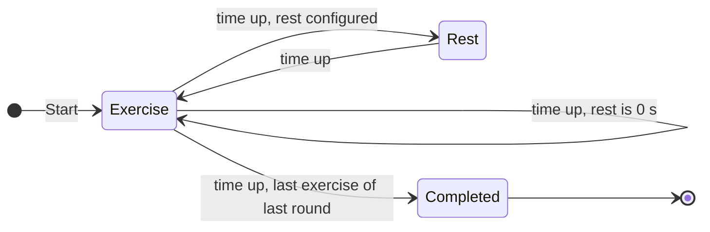

# Workout Timer — Specification

| | |
|---|---|
| **Status** | Draft v0.1, open for refinement |
| **Last updated** | 2026-11-02 |
| **Platform** | Android tablet, single user, personal use |

This document describes *what* the app does. Once it is agreed, it becomes the base for the implementation plan.

How to read it:

- Every requirement has an ID (`EX-1`, `TTS-2`, …) so that the implementation plan and later discussions can refer to it.
- **Requested** marks requirements that come from the original brief.
- **Proposed** marks suggestions that still need to be accepted, changed or dropped.
- Unresolved points are listed in [§8 Open questions](#8-open-questions), each with the assumption this draft makes for now.

---

## Contents

1. [Purpose](#1-purpose)
2. [Scope](#2-scope)
3. [Target device](#3-target-device)
4. [Concepts](#4-concepts)
5. [Functional requirements](#5-functional-requirements)
6. [Screens](#6-screens)
7. [Non-functional requirements](#7-non-functional-requirements)
8. [Open questions](#8-open-questions)
9. [Future ideas](#9-future-ideas)
10. [Change log](#10-change-log)

---

## 1. Purpose

An interval timer that guides a workout made of **rounds** of timed **exercises**. You start it and follow it hands-free: the screen shows where you are and how much time is left, and spoken cues announce each exercise and count down its last seconds.

The app runs on one specific tablet (see §3). It is installed directly from the development machine; it is not published on an app store.

## 2. Scope

### In scope (v1)

- Defining workouts made of rounds and exercises, with configurable durations and rests.
- Running a workout with a countdown timer, pause and resume.
- Spoken cues using the device's built-in text-to-speech (TTS).
- Storing workouts on the device.

### Out of scope (v1)

- Accounts, cloud sync, or any network use.
- Publishing on Google Play.
- Fitness tracking (heart rate, calories) and workout history/statistics (see [§9](#9-future-ideas)).
- Music playback inside the app.

## 3. Target device

Information read from the tablet with `adb` on 2026-11-02.

| Property | Value |
|---|---|
| Device | HUAWEI MediaPad T5 10 (model `AGS2-W09`) |
| OS | Android 8.0.0, **API level 26**, EMUI 8.0 |
| CPU ABI | `arm64-v8a` (also `armeabi-v7a`) |
| Memory | ~3 GB RAM |
| Screen | 1200 × 1920 px, 320 dpi (xhdpi) → **600 × 960 dp** in portrait, 960 × 600 dp in landscape |
| Auto-rotate | Enabled |
| System language | Spanish (`es-ES`), time zone Europe/Madrid |
| TTS engine | Google Speech Services (`com.google.android.tts`), the default and only engine installed. No TTS language is forced in settings, so it follows the system language (Spanish). |
| Google Play Services | Present |

What this means for the app:

- **Minimum SDK is 26.** Platform APIs added after Android 8.0 can only be used with a fallback.
- TTS must work **offline**. The voice data for the chosen language must be installed in the Google TTS settings (*not yet verified on the device*).
- EMUI is aggressive about stopping apps that run in the background. This supports the foreground-only design in `EX-10`.
- The layout targets a 10" screen (smallest width 600 dp). Phone layouts are not needed.

## 4. Concepts

### 4.1 Glossary

| Term | Meaning |
|---|---|
| **Workout** | A named routine: an ordered list of rounds plus the timing settings below. It is what you start, pause and finish. |
| **Round** | A named, ordered list of one or more exercises. A round ends when its last exercise finishes. |
| **Exercise** | A named activity with a duration in seconds. |
| **Default exercise duration** | A workout-level duration used by every exercise that doesn't define its own. |
| **Exercise rest** | The pause between two consecutive exercises of the same round, in seconds. |
| **Round rest** | The pause between the end of one round and the start of the next, in seconds. |
| **Phase** | One step of a running workout: an exercise or a rest. |

A rest of **0 seconds means no rest**: the next exercise or round starts immediately.

### 4.2 Structure

```
Workout
├── name
├── default exercise duration (s)
├── exercise rest (s, ≥ 0)
├── round rest (s, ≥ 0)
└── rounds (ordered, at least 1)
    ├── name
    └── exercises (ordered, at least 1)
        ├── name
        └── duration (s), optional: falls back to the default exercise duration
```

Exercises without their own duration follow the default. Changing the default updates all of them at once. Exercises with their own duration keep it.

### 4.3 Sequencing rules

1. The workout starts with the first exercise of the first round.
2. Inside a round, exercises run in order, with the **exercise rest** between each pair.
3. After the last exercise of a round, the **round rest** runs, then the first exercise of the next round starts. The exercise rest is *not* added on top: only one rest runs between rounds.
4. After the last exercise of the last round, the workout ends. No rest runs at the end.
5. A rest of 0 s is skipped entirely: the next phase starts immediately.



You can pause from any running phase. Resuming returns to the same phase with the same remaining time.

### 4.4 Example

Workout "Example": default exercise duration 40 s, exercise rest 15 s, round rest 60 s.

- Round 1 "Warm-up": Jumping jacks (30 s), Arm circles (10 s), High knees (default)
- Round 2 "Core": Plank (60 s), Crunches (default)

| # | Phase | Round | Name | Duration | Voice cues |
|---|---|---|---|---|---|
| 1 | Exercise | Warm-up | Jumping jacks | 30 s | "Jumping jacks" · 3-2-1 |
| 2 | Exercise rest | Warm-up | — | 15 s | |
| 3 | Exercise | Warm-up | Arm circles | 10 s | 3-2-1 (no name: not longer than 10 s) |
| 4 | Exercise rest | Warm-up | — | 15 s | |
| 5 | Exercise | Warm-up | High knees | 40 s | "High knees" · 3-2-1 |
| 6 | Round rest | — | — | 60 s | |
| 7 | Exercise | Core | Plank | 60 s | "Plank" · 3-2-1 |
| 8 | Exercise rest | Core | — | 15 s | |
| 9 | Exercise | Core | Crunches | 40 s | "Crunches" · 3-2-1 |
| | **Completed** | | | **Total 4:45** | |

The voice cues column only shows the requested cues (`TTS-1`, `TTS-2`). Proposed cues such as `TTS-5` and `TTS-6` would add more.

## 5. Functional requirements

### 5.1 Workout execution

| ID | Requirement | Source |
|---|---|---|
| EX-1 | Starting a workout runs its phases following the sequencing rules in §4.3. | Requested |
| EX-2 | Each exercise lasts its configured duration. The remaining time counts down to zero, then the next phase starts automatically. | Requested |
| EX-3 | Rests between exercises and between rounds last their configured duration. A value of 0 s means no rest. | Requested |
| EX-4 | The user can **pause** a running exercise and **resume** it. Resuming continues from the remaining time; it does not restart the exercise. | Requested |
| EX-5 | Pause and resume also work during rests. | Proposed |
| EX-6 | When the last exercise of the last round finishes, the workout ends and a completion screen is shown. | Proposed |
| EX-7 | A **get-ready** countdown (e.g. 10 s) runs before the first exercise, so there is time to get into position after pressing Start. | Proposed |
| EX-8 | The user can **stop** the workout early, after confirming, and return to the workout list. | Proposed |
| EX-9 | The user can **skip** to the next phase or go back to the start of the previous exercise. | Proposed |
| EX-10 | If the app leaves the foreground (Home button, switching apps, screen turned off), the running workout pauses automatically. The workout only runs while the app is on screen. | Proposed |

### 5.2 Workout screen

The screen must be readable at a glance from a few metres away while exercising.

| ID | Requirement | Source |
|---|---|---|
| UI-1 | Shows the current **round name**. | Requested |
| UI-2 | Shows the current **exercise name**. | Requested |
| UI-3 | Shows the **time**: the remaining time of the current phase as `mm:ss`, rounded up to the whole second. It shows `00:40` at the start of a 40 s exercise and `00:01` during its last second. | Requested |
| UI-4 | Has a control to **pause / resume**. | Requested |
| UI-5 | During a rest, shows "Rest" with its remaining time and the name of the **next exercise** (and the next round, if a new one starts). | Proposed |
| UI-6 | Shows progress: exercise *n* of *m* in the round, round *n* of *m*. | Proposed |
| UI-7 | Exercise, rest and paused states each have their own background colour, so the current state is clear from a distance. | Proposed |
| UI-8 | Tapping anywhere on the screen toggles pause/resume, in addition to the explicit button. | Proposed |
| UI-9 | Shows the total remaining time of the workout. | Proposed |

### 5.3 Voice cues (TTS)

Voice cues use Android's built-in text-to-speech service with the device's default engine (Google Speech Services).

| ID | Requirement | Source |
|---|---|---|
| TTS-1 | When an exercise starts and its duration is **longer than 10 s**, the exercise name is spoken. | Requested |
| TTS-2 | When **3 s** remain in an exercise, a countdown is spoken: "three", "two", "one". There is one word per second, spoken as the display changes to 3, 2 and 1. An exercise of 3 s or less starts the countdown at its own duration. | Requested |
| TTS-3 | Pausing stops any speech in progress. Nothing is replayed on resume; the countdown carries on from the current second. | Proposed |
| TTS-4 | The cues work without a network connection. | Proposed |
| TTS-5 | The same 3-2-1 countdown is spoken at the end of rests, warning that the next exercise is about to start. | Proposed |
| TTS-6 | When a rest starts, it is announced and the next exercise is named, e.g. "Rest. Next: squats". | Proposed |
| TTS-7 | "Workout complete" is spoken at the end. | Proposed |
| TTS-8 | Other audio (e.g. music playing in another app) is lowered while a cue is spoken, then restored. | Proposed |
| TTS-9 | A setting turns voice cues on or off. | Proposed |

Note on `TTS-1` and `TTS-2`: the 10 s threshold leaves at least 7 s between the spoken name and the start of the countdown, so the two cues never overlap.

### 5.4 Workout management

| ID | Requirement | Source |
|---|---|---|
| WM-1 | Each exercise has a **name** and a **duration** in seconds. A workout-level default duration applies to every exercise that doesn't set its own. | Requested |
| WM-2 | The exercise rest and round rest are configured in seconds; 0 means no rest. | Requested |
| WM-3 | Several workouts can be saved on the device and are listed on the home screen. | Proposed |
| WM-4 | Workouts can be created, edited, duplicated and deleted in the app. | Proposed |
| WM-5 | In the editor, rounds and exercises can be added, renamed, reordered, duplicated and removed. | Proposed |
| WM-6 | The editor and the workout list show the workout's computed total duration, rests included. | Proposed |
| WM-7 | Validation: the workout and each round need a name; a workout has at least one round; a round has at least one exercise; durations are at least 1 s; rests are 0 s or more. | Proposed |
| WM-8 | Workouts are stored locally and survive app restarts and device reboots. | Proposed |

## 6. Screens

| Screen | Purpose | Main actions |
|---|---|---|
| **Workout list** (home) | Shows saved workouts with their total duration | Start, edit, duplicate, delete, new workout |
| **Workout editor** | Edits a workout's name, default exercise duration, rests, rounds and exercises | Save, cancel |
| **Workout runner** | Runs the workout (see §5.1–§5.3) | Pause/resume, stop, skip (if accepted) |
| **Workout completed** | Confirms the end and shows a short summary (total time, rounds and exercises done) | Back to list |

Runner screen sketches (landscape, low fidelity, layout only):

During an exercise:

```
+--------------------------------------------------------------+
| Round 2/3 · Legs                                Exercise 2/4 |
|                                                              |
|                            SQUATS                            |
|                                                              |
|                            00:27                             |
|                                                              |
|                         Next: Lunges                         |
|                                                              |
|                         [ || Pause ]                         |
|                                                              |
+--------------------------------------------------------------+
```

During a rest:

```
+--------------------------------------------------------------+
| Round 2/3 · Legs                                Exercise 2/4 |
|                                                              |
|                             REST                             |
|                                                              |
|                            00:12                             |
|                                                              |
|                     Next: Lunges (40 s)                      |
|                                                              |
|                         [ || Pause ]                         |
|                                                              |
+--------------------------------------------------------------+
```

## 7. Non-functional requirements

| ID | Requirement |
|---|---|
| NF-1 | **Timer accuracy:** remaining time is computed from a monotonic clock, not by adding up timer ticks, so errors don't build up. A 60-minute workout ends within ±1 s of real elapsed time, and pausing doesn't change this. |
| NF-2 | **Screen stays on** while the runner screen is open. |
| NF-3 | **Robust to configuration changes:** rotating the device or similar events don't reset, pause or skip the running workout. |
| NF-4 | **Offline and private:** no network permission, no accounts, no analytics. |
| NF-5 | **Compatibility:** runs on Android 8.0 (API 26) on the target device. |
| NF-6 | **Readability:** the time and exercise name are readable from about 3 m away. Touch targets are large. |
| NF-7 | **Distribution:** installed as an APK from the development machine (`adb` / Android Studio). |

## 8. Open questions

Each question lists the assumption this draft uses until it is answered.

| # | Question | Draft assumption |
|---|---|---|
| Q1 | **TTS language.** The tablet is set to Spanish, so the default voice speaks Spanish. Should the countdown be "three, two, one" (English) or "tres, dos, uno" (Spanish)? Exercise names are read by the same voice, so they should be written in that language. | Configurable, defaulting to the device language (Spanish) |
| Q2 | **How are workouts created?** With an editor in the app, by importing a file (e.g. JSON written on the PC and copied with `adb`), or both? | Editor in the app (`WM-4`, `WM-5`) |
| Q3 | Are the rest times one value per workout, or can a round or exercise **override** them? | One value of each per workout |
| Q4 | Can a round be **repeated** N times (e.g. "Round 1 × 3"), or is each round run once? | Each round runs once; duplicating a round gives the same result |
| Q5 | **Name announcement threshold:** is "longer than 10 s" strict (a 10 s exercise is not announced)? Should the threshold be a setting? | Strict, fixed at 10 s |
| Q6 | Should the 3-2-1 countdown also be spoken at the **end of rests** (`TTS-5`)? | Yes |
| Q7 | Should there be a **get-ready** countdown before the first exercise (`EX-7`)? How long? | Yes, 10 s |
| Q8 | **Orientation:** landscape, portrait or both? Where is the tablet placed during a workout? | Landscape only |
| Q9 | Besides pause/resume, which runner **controls** are wanted: stop, skip next, previous (`EX-8`, `EX-9`)? | Stop and skip next/previous |
| Q10 | When the app **leaves the foreground**, should the workout pause (`EX-10`) or keep running in the background? | Pause |
| Q11 | Besides the voice, should there be **sound effects**, e.g. a beep at each phase change? | Voice only |
| Q12 | **UI language:** English or Spanish? | English text, kept in resource files so it can be translated later |
| Q13 | Will **music** be playing from another app during workouts (relevant for `TTS-8`)? | Yes, so cues lower the music |

## 9. Future ideas

Not planned for v1; listed so they are not lost.

- Workout history: date, workout, completed or stopped.
- Export/import workouts as JSON, for backup and for editing on the PC.
- Rest overrides per round or exercise (if Q3 is answered "no" for v1).
- Round repetitions (if Q4 is answered "no" for v1).
- Notes or an image per exercise.
- Speed or volume settings for the voice.

## 10. Change log

| Version | Date | Changes |
|---|---|---|
| 0.1 | 2026-11-02 | First draft from the initial brief and the device information. |
