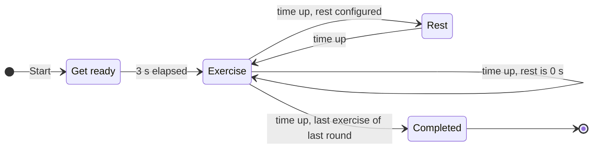

# Workout Timer — Specification

| | |
|---|---|
| **Status** | Draft v0.5, plan review applied |
| **Last updated** | 2026-11-02 |
| **Platform** | Android tablet, single user, personal use |

This document describes *what* the app does. Once it is agreed, it becomes the base for the implementation plan.

How to read it:

- Every requirement has an ID (`EX-1`, `TTS-2`, …) so that the implementation plan and later discussions can refer to it. IDs are never reused. Discarded proposals keep their ID and are listed in [§9.2](#92-discarded-proposals).
- The **Source** column says where a requirement comes from:
  - **Requested**: asked for in the original brief or in review answers.
  - **Agreed**: a proposal accepted in review.
  - **Proposed**: a suggestion still waiting for review.
- Unresolved points are listed in [§8 Open questions](#8-open-questions), each with the assumption this draft makes for now.

---

## Contents

1. [Purpose](#1-purpose)
2. [Scope](#2-scope)
3. [Target device](#3-target-device)
4. [Concepts](#4-concepts)
5. [Functional requirements](#5-functional-requirements)
6. [Screens](#6-screens)
7. [Non-functional requirements](#7-non-functional-requirements)
8. [Open questions](#8-open-questions)
9. [Decisions](#9-decisions)
10. [Future ideas](#10-future-ideas)
11. [Change log](#11-change-log)

---

## 1. Purpose

An interval timer that guides a workout made of **rounds** of timed **exercises**. You start it and follow it hands-free:

- the screen shows where you are and how much time is left in the current exercise or rest;
- spoken cues announce each exercise and count down its last seconds;
- a short sound marks the end of each round.

The app is a simple timer. It runs on one specific tablet (see §3) and is installed directly from the development machine; it is not published on an app store.

## 2. Scope

### In scope (v1)

- Creating and editing workouts in the app: rounds, exercises, durations and rests.
- Running a workout with a countdown timer, pause/resume, and next/previous/stop controls while paused.
- Spoken cues in English using the device's built-in text-to-speech (TTS), plus a round-end sound.
- Storing workouts on the device.

### Out of scope (v1)

- Accounts, cloud sync, or any network use.
- Publishing on Google Play.
- Importing workouts from files. Workouts are created only in the app's editor.
- Music playback, or adjusting the audio of other apps.
- Fitness tracking (heart rate, calories) and workout history/statistics.
- Portrait layout. The app is landscape only for now.
- Languages other than English. A Spanish translation may come later (see [§10](#10-future-ideas)).

## 3. Target device

Information read from the tablet with `adb` on 2026-11-02.

| Property | Value |
|---|---|
| Device | HUAWEI MediaPad T5 10 (model `AGS2-W09`) |
| OS | Android 8.0.0, **API level 26**, EMUI 8.0 |
| CPU ABI | `arm64-v8a` (also `armeabi-v7a`) |
| Memory | ~3 GB RAM |
| Screen | 1200 × 1920 px, 320 dpi (xhdpi) → **960 × 600 dp in landscape** |
| Auto-rotate | Enabled |
| System language | Spanish (`es-ES`), time zone Europe/Madrid |
| TTS engine | Google Speech Services (`com.google.android.tts`), the default and only engine installed. No TTS language is forced in settings, so by default it follows the system language (Spanish). Installed voices: Spanish (Spain) and English (United States). |
| Google Play Services | Present |

What this means for the app:

- **Minimum SDK is 26.** Platform APIs added after Android 8.0 can only be used with a fallback.
- **Voice cues are always in English** (`TTS-11`), but the system language is Spanish. The app has to select English (United States) explicitly. That voice is installed on the device, so cues work offline.
- EMUI is aggressive about stopping apps that run in the background. This supports the foreground-only design in `EX-10`.
- The layout targets a 10" screen in landscape (960 × 600 dp). Phone layouts are not needed.

## 4. Concepts

### 4.1 Glossary

| Term | Meaning |
|---|---|
| **Workout** | A named routine: an ordered list of rounds plus default timings. It is what you start, pause and finish. |
| **Round** | A named, ordered list of one or more exercises. A round ends when its last exercise finishes. |
| **Exercise** | A named activity with a duration in seconds. |
| **Default exercise duration** | A workout-level duration used by every exercise that doesn't set its own. |
| **Exercise rest** | The pause after an exercise, before the next exercise of the same round. The workout sets a default; any exercise can set its own. |
| **Round rest** | The pause after a round, before the next round. The workout sets a default; any round can set its own. |
| **Get ready** | A 3-second countdown before the first exercise of the workout. |
| **Phase** | One step of a running workout: get ready, an exercise, or a rest. |

A rest of **0 seconds means no rest**: the next exercise or round starts immediately.

### 4.2 Structure

```
Workout
├── name
├── default exercise duration (s)
├── default exercise rest (s, ≥ 0)
├── default round rest (s, ≥ 0)
└── rounds (ordered, at least 1)
    ├── name
    ├── round rest (s), optional: falls back to the default round rest
    └── exercises (ordered, at least 1)
        ├── name
        ├── duration (s), optional: falls back to the default exercise duration
        └── rest (s), optional: falls back to the default exercise rest
```

- **Defaults:** an optional value that isn't set falls back to the workout default. Changing a default updates every exercise or round that doesn't set its own value. Those that set their own keep it.
- **Unused values:** two values are never used. The last exercise of a round has no exercise rest, because the round rest runs instead. The last round has no round rest, because the workout ends. The editor marks these fields as not applicable but keeps their values, so they apply again if the exercise or round is moved.

### 4.3 Sequencing rules

1. Pressing Start runs the **get-ready** countdown (3 s).
2. The first exercise of the first round starts.
3. Inside a round, each exercise is followed by **that exercise's rest**, then the next exercise starts.
4. When the last exercise of a round finishes:
   - the round-end sound plays;
   - **that round's rest** runs (the exercise's own rest is not added on top);
   - the first exercise of the next round starts.
5. When the last exercise of the last round finishes, the workout ends:
   - no rest runs and no round-end sound plays;
   - "Workout complete. Well done!" is spoken.
6. A rest of 0 s is skipped entirely: the next exercise starts immediately.



Any phase can be paused. Resuming returns to the same phase with the same remaining time. While paused, you can also move to the next or previous exercise, or stop the workout (`EX-8`, `EX-9`).

### 4.4 Example

Workout "Example" has these defaults: exercise duration 40 s, exercise rest 15 s, round rest 60 s.

- Round 1 "Warm-up", own round rest 30 s:
  - Jumping jacks: 30 s
  - Arm circles: 10 s, own rest 5 s
  - High knees: default duration
- Round 2 "Core":
  - Plank: 60 s, own rest 30 s
  - Crunches: default duration

| # | Phase | Round | Name | Duration | Audio |
|---|---|---|---|---|---|
| 1 | Get ready | — | — | 3 s | "Get ready in" · 3-2-1 |
| 2 | Exercise | Warm-up | Jumping jacks | 30 s | "Jumping jacks" · 3-2-1 |
| 3 | Exercise rest | Warm-up | — | 15 s (default) | silent |
| 4 | Exercise | Warm-up | Arm circles | 10 s | 3-2-1 (no name: not longer than 10 s) |
| 5 | Exercise rest | Warm-up | — | 5 s (own) | silent |
| 6 | Exercise | Warm-up | High knees | 40 s (default) | "High knees" · 3-2-1 |
| 7 | Round rest | — | — | 30 s (own) | round-end sound, then silent |
| 8 | Exercise | Core | Plank | 60 s | "Plank" · 3-2-1 |
| 9 | Exercise rest | Core | — | 30 s (own) | silent |
| 10 | Exercise | Core | Crunches | 40 s (default) | "Crunches" · 3-2-1 |
| | **Completed** | | | **Total 4:23** | "Workout complete. Well done!" |

The total runs from Start to completion: get ready 3 s + exercises 180 s + exercise rests 50 s + round rest 30 s.

## 5. Functional requirements

### 5.1 Workout execution

| ID | Requirement | Source |
|---|---|---|
| EX-1 | Starting a workout runs its phases following the sequencing rules in §4.3. | Requested |
| EX-2 | Each exercise lasts its configured duration. The remaining time counts down to zero, then the next phase starts automatically. | Requested |
| EX-3 | Each rest lasts its configured duration. A value of 0 s means no rest. | Requested |
| EX-4 | The user can **pause** a running exercise and **resume** it. Resuming continues from the remaining time; it does not restart the exercise. | Requested |
| EX-5 | Pause and resume also work during rests and the get-ready countdown. | Agreed |
| EX-6 | When the last exercise of the last round finishes, the workout ends and a completion screen is shown. | Agreed |
| EX-7 | A **get-ready** countdown of **3 s** runs before the first exercise of the first round, and only there. The screen shows "Get ready", the countdown, and the name of the first exercise. The voice for it is described in `TTS-10`. | Agreed |
| EX-8 | While paused, **Stop** asks for confirmation, then ends the workout and returns to the workout list. | Agreed |
| EX-9 | While paused, **Next** and **Previous** move to another exercise without asking for confirmation (see the table below). | Agreed |
| EX-10 | If the app leaves the foreground (Home button, switching apps, screen turned off), the running workout pauses automatically. The workout only runs while the app is on screen. | Agreed |
| EX-11 | If Android closes the app while it's in the background (for example, to free memory), the paused workout is not restored. The app reopens on the workout list. | Requested |

What Next and Previous do:

- They move between **exercises** and skip any rest in between.
- After moving, the workout stays **paused** at the start of the target exercise. Resume starts that exercise as normal, including its name announcement (`TTS-1`).

| Paused during | Next | Previous |
|---|---|---|
| Get ready | First exercise | Not available |
| An exercise | Next exercise; on the last exercise of the workout, ends the workout (completion screen) | Previous exercise; on the first exercise, restarts it |
| A rest | The exercise after the rest | The exercise before the rest |

### 5.2 Workout screen

The screen must be readable at a glance from a few metres away while exercising.

| ID | Requirement | Source |
|---|---|---|
| UI-1 | Shows the current **round name**. | Requested |
| UI-2 | Shows the current **exercise name**. | Requested |
| UI-3 | Shows the **time**: the remaining time of the **current phase only** (exercise, rest or get ready) as `mm:ss`, rounded up to the whole second. It shows `00:40` at the start of a 40 s exercise and `00:01` during its last second. The remaining time of the whole workout is not shown. | Requested |
| UI-4 | Has a control to **pause / resume**. | Requested |
| UI-5 | During a rest, shows "Rest" with its remaining time and the name and duration of the **next exercise**. If a new round starts after the rest, the next round's name is shown too. | Agreed |
| UI-6 | Shows progress: exercise *n* of *m* in the round, round *n* of *m*. | Agreed |
| UI-7 | Exercise, rest and paused states each have their own background colour, so the current state is clear from a distance. | Agreed |
| UI-10 | While a phase is running, the only button shown is **Pause**. | Requested |
| UI-11 | While paused, the buttons shown are **Resume**, **Previous**, **Next** and **Stop**, and the screen clearly says the workout is paused. | Requested |

### 5.3 Audio cues

Voice cues use Android's built-in text-to-speech service with the device's default engine (Google Speech Services), always in English.

| ID | Requirement | Source |
|---|---|---|
| TTS-1 | When an exercise starts and its duration is **longer than 10 s**, the exercise name is spoken. The rule is strict: a 10 s exercise is not announced. | Requested |
| TTS-2 | When **3 s** remain in an exercise, a countdown is spoken: "three", "two", "one". There is one word per second, spoken as the display changes to 3, 2 and 1. An exercise of 3 s or less starts the countdown at its own duration. | Requested |
| TTS-3 | Pausing stops any speech in progress. Nothing is replayed on resume; the countdown carries on from the current second. | Agreed |
| TTS-4 | The cues work without a network connection. The app doesn't need the network at all. | Agreed |
| TTS-7 | When the workout ends, "Workout complete. Well done!" is spoken. | Agreed |
| TTS-9 | A setting turns voice cues on or off. The choice is remembered. With voice cues off, the timer, the screen and the round-end sound work the same. | Agreed |
| TTS-10 | **Get ready:** "Get ready in" is spoken first. When it finishes, the 3 s countdown starts, with "three", "two", "one" spoken in sync with the display. With voice cues off, the countdown starts immediately. | Requested |
| TTS-11 | Voice cues are always spoken in **English**, using the English (United States) voice, whatever the device language. | Requested |
| TTS-12 | **Rests are silent:** no voice cues are spoken during exercise rests or round rests. | Requested |
| SND-1 | A short **sound** plays when a round ends, at the start of the round rest. It doesn't play after the last round. If the round rest is 0 s, the next exercise's name (`TTS-1`) is spoken after the sound finishes. | Requested |
| SND-2 | There are no other sound effects. Exercises are marked only by the voice cues. | Requested |

Note on `TTS-1` and `TTS-2`: the 10 s threshold leaves at least 7 s between the spoken name and the start of the countdown, so the two cues never overlap.

### 5.4 Workout management

| ID | Requirement | Source |
|---|---|---|
| WM-1 | Each exercise has a **name** and a **duration** in seconds. A workout-level default duration applies to every exercise that doesn't set its own. | Requested |
| WM-2 | Rests are set in seconds; 0 means no rest. The workout sets a default exercise rest and a default round rest. Each exercise can set its **own rest**, used after it. Each round can set its **own round rest**, used after it. | Requested |
| WM-3 | Several workouts can be saved on the device and are listed on the home screen. | Agreed |
| WM-4 | Workouts can be created, edited, duplicated and deleted in the app. The editor is the only way to create workouts. | Agreed |
| WM-5 | In the editor, rounds and exercises can be added, renamed, reordered, duplicated and removed. To repeat a round, duplicate it. | Agreed |
| WM-6 | The editor and the workout list show the workout's total duration, from Start to completion: get ready, exercises and rests. | Agreed |
| WM-7 | Validation: the workout and each round need a name; a workout has at least one round; a round has at least one exercise; durations are at least 1 s; rests are 0 s or more. | Agreed |
| WM-8 | Workouts are stored locally and survive app restarts and device reboots. There is no cloud backup: uninstalling the app deletes them. | Agreed |
| WM-9 | Deleting a workout asks for confirmation. | Requested |
| WM-10 | Leaving the editor with unsaved changes asks for confirmation before discarding them. | Requested |

## 6. Screens

All screens are landscape.

| Screen | Purpose | Main actions |
|---|---|---|
| **Workout list** (home) | Shows saved workouts with their total duration | Start, edit, duplicate, delete (with confirmation), new workout, open settings |
| **Workout editor** | Edits a workout's name, defaults, rounds and exercises, including their own durations and rests | Save, cancel (asks for confirmation if there are unsaved changes) |
| **Workout runner** | Runs the workout (see §5.1–§5.3) | Running: pause. Paused: resume, previous, next, stop. |
| **Workout completed** | Shows a "Well done!" message and a short summary (total time, rounds and exercises done) | Back to list |
| **Settings** | App-wide settings: voice cues on/off (`TTS-9`) | Back |

Runner screen sketches (low fidelity, layout only):

Exercise running:

```
+--------------------------------------------------------------+
| Round 2/3 · Legs                                Exercise 2/4 |
|                                                              |
|                            SQUATS                            |
|                                                              |
|                            00:27                             |
|                                                              |
|                                                              |
|                         [ || Pause ]                         |
|                                                              |
+--------------------------------------------------------------+
```

Rest running:

```
+--------------------------------------------------------------+
| Round 2/3 · Legs                                             |
|                                                              |
|                             REST                             |
|                                                              |
|                            00:12                             |
|                                                              |
|                     Next: Lunges (40 s)                      |
|                                                              |
|                         [ || Pause ]                         |
|                                                              |
+--------------------------------------------------------------+
```

Paused:

```
+--------------------------------------------------------------+
| Round 2/3 · Legs                                Exercise 2/4 |
|                                                              |
|                            SQUATS                            |
|                            PAUSED                            |
|                            00:27                             |
|                                                              |
|         [ |< Previous ]   [ > Resume ]   [ Next >| ]         |
|                                                              |
|                           [ Stop ]                           |
|                                                              |
+--------------------------------------------------------------+
```

## 7. Non-functional requirements

| ID | Requirement |
|---|---|
| NF-1 | **Timer accuracy:** remaining time is computed from a monotonic clock, not by adding up timer ticks, so errors don't build up. A 60-minute workout ends within ±1 s of real elapsed time, and pausing doesn't change this. |
| NF-2 | **Screen stays on** while the runner screen is open. |
| NF-3 | **Robust to configuration changes:** events such as flipping the tablet between the two landscape orientations don't reset, pause or skip the running workout. |
| NF-4 | **Offline and private:** no network permission, no accounts, no analytics. |
| NF-5 | **Compatibility:** runs on Android 8.0 (API 26) on the target device. |
| NF-6 | **Readability:** the time and exercise name are readable from about 3 m away. Touch targets are large. |
| NF-7 | **Distribution:** installed as an APK from the development machine (`adb` / Android Studio). |
| NF-8 | **Landscape only:** the app follows the sensor between the two landscape orientations and never shows portrait. |
| NF-9 | **Language:** the UI is in English. All user-facing text lives in resource files, so a Spanish translation can be added later without code changes. |

## 8. Open questions

None at the moment. New questions are numbered from Q19, and each one lists the assumption the draft uses until it is answered.

## 9. Decisions

### 9.1 Answered questions

| # | Question | Decision |
|---|---|---|
| Q1 | TTS language | English. Exercise names are written in English. |
| Q2 | How workouts are created | Only with the editor in the app |
| Q3 | Rest overrides | Each exercise and each round can set its own rest (`WM-2`) |
| Q4 | Round repetitions | No. A round is repeated by duplicating it in the editor. |
| Q5 | Name announcement threshold | Strictly longer than 10 s, fixed |
| Q6 | Countdown at the end of rests | No. Rests are silent (`TTS-12`). |
| Q7 | Get-ready countdown | Yes, 3 s, with "Get ready in three, two, one" (`EX-7`, `TTS-10`) |
| Q8 | Orientation | Landscape only for now (`NF-8`) |
| Q9 | Runner controls | Running: Pause only. Paused: Resume, Previous, Next, Stop. Stop asks for confirmation; Next and Previous don't. (`UI-10`, `UI-11`, `EX-8`, `EX-9`) |
| Q10 | Leaving the app | The workout pauses (`EX-10`) |
| Q11 | Sound effects | Only when a round ends (`SND-1`) |
| Q12 | UI language | English for now, translatable to Spanish later (`NF-9`) |
| Q13 | Music in the background | No music (`TTS-8` discarded) |
| Q14 | Next / Previous behaviour | They jump between exercises and skip rests. The workout stays paused at the target exercise. (`EX-9`) |
| Q15 | When the round-end sound plays | When the round ends, at the start of the round rest (`SND-1`) |
| Q16 | Does the voice setting mute the round-end sound? | No. It only affects the voice (`TTS-9`). |
| Q17 | Meaning of "own rest" | Each exercise and each round has its own rest, played after it. The last exercise of a round doesn't play its own rest; the round rest plays instead, if it isn't 0 s. (`WM-2`, §4.3) |
| Q18 | How the default rests behave | Linked, the same as the default exercise duration. An exercise or round without its own rest uses the workout default, and changing the default updates all of them. (§4.2) |

### 9.2 Discarded proposals

| ID | Proposal | Reason |
|---|---|---|
| UI-8 | Tap anywhere on the screen to pause/resume | The explicit buttons are used instead |
| UI-9 | Show the total remaining workout time | Only the current exercise or rest time is shown |
| TTS-5 | 3-2-1 countdown at the end of rests | Rests are silent |
| TTS-6 | Announce rests and the next exercise | Rests are silent |
| TTS-8 | Lower other apps' audio during cues | No music is played; the app is a simple timer |

## 10. Future ideas

Not planned for v1; listed so they are not lost.

- Spanish translation of the UI (`NF-9`), and possibly Spanish voice cues.
- Portrait layout.
- Workout history: date, workout, completed or stopped.
- Backup and restore of workouts, since uninstalling the app deletes them.
- Notes or an image per exercise.
- Speed or volume settings for the voice.

## 11. Change log

| Version | Date | Changes |
|---|---|---|
| 0.1 | 2026-11-02 | First draft from the initial brief and the device information. |
| 0.2 | 2026-11-02 | First review. Proposals accepted or discarded; Q1–Q13 answered. Added: rests per exercise and per round, 3 s get-ready, controls shown only while paused, round-end sound, English-only voice and UI, landscape only, Settings screen. New questions Q14–Q17. |
| 0.3 | 2026-11-02 | Second review: Q14–Q17 answered, confirming the draft assumptions. The English voice is pinned to English (United States), which is installed on the device. Rest fields that don't apply keep their values. New question Q18 on rest defaults. |
| 0.4 | 2026-11-02 | Q18 answered: default rests are linked, as for durations. No open questions remain. |
| 0.5 | 2026-11-02 | From the implementation plan review (PQ-3 to PQ-5): added `EX-11` (a workout isn't restored after Android closes the app), and `WM-9` and `WM-10` (confirmations). `WM-8` now says there is no cloud backup. |
