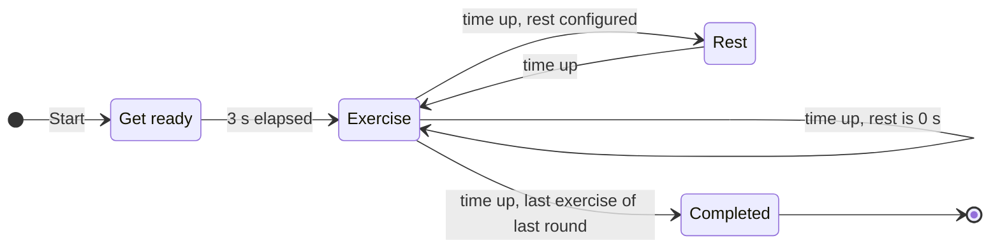
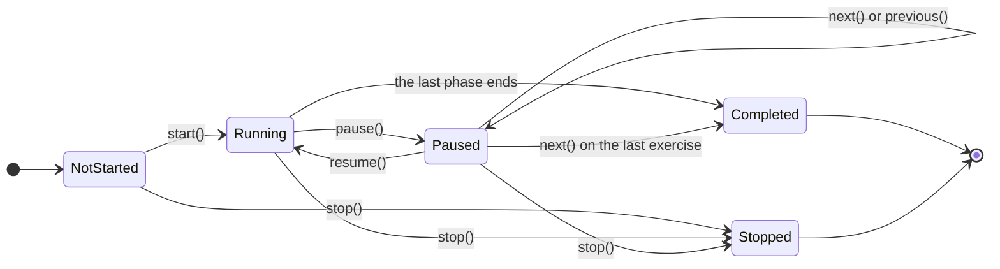

# P4 — Workout engine: Specification

| | |
|---|---|
| **Status** | Draft v0.1 |
| **Phase** | P4, see [Implementation plan §5](../../IMPLEMENTATION_PLAN.md#5-phases) |
| **Depends on** | P2 (done) |
| **Branch** | `phase/p4-engine` |
| **Handover** | [HANDOVER.md](HANDOVER.md) |

This document holds everything needed to implement the phase. Working on it shouldn't require reading the full specification or plan.

## 1. Goal

The engine that runs a workout's timeline in real time. A `WorkoutSession` walks the phases on a monotonic clock and takes the runner's commands: start, pause, resume, next, previous and stop. It publishes a state for the screen and events for the audio. It lives in `:core` as plain Kotlin, and its timing is exact: late timer wake-ups never shift the schedule.

Later phases build on it:

| Phase | Uses |
|---|---|
| P5 | turns the session's events into voice and sound cues, and reports when "Get ready in" has been spoken |
| P7 | the runner ViewModel owns a session, sends it the user's commands and shows its state |
| P8 | connects the two, and checks accuracy in a real 60-minute run |

## 2. Requirements covered

Quoted from [SPECIFICATION.md](../../SPECIFICATION.md) v0.6.

| ID | Requirement (quoted) | What this phase does for it |
|---|---|---|
| EX-1 | "Starting a workout runs its phases following the sequencing rules in §4.3." | Runs P2's timeline phase by phase. The timeline already applies the rules; P4 adds time. |
| EX-2 | "Each exercise lasts its configured duration. The remaining time counts down to zero, then the next phase starts automatically." | Remaining time comes from the clock. At zero, the next phase starts at the exact end time. |
| EX-3 | "Each rest lasts its configured duration. A value of 0 s means no rest." | Rest phases run like exercises. A 0 s rest has no phase in the timeline, so nothing runs. |
| EX-4 | "The user can **pause** a running exercise and **resume** it. Resuming continues from the remaining time; it does not restart the exercise." | `pause()` and `resume()`, keeping the time left to the millisecond. |
| EX-5 | "Pause and resume also work during rests and the get-ready countdown." | The same commands work in every phase, including while "Get ready in" is being spoken. |
| EX-6 | "When the last exercise of the last round finishes, the workout ends and a completion screen is shown." | The session completes and sends `Completed`. P7 shows the screen. |
| EX-7 | "A **get-ready** countdown of **3 s** runs before the first exercise of the first round, and only there. The screen shows "Get ready", the countdown, and the name of the first exercise. The voice for it is described in `TTS-10`." | The get-ready phase waits for the announcement, then counts down 3 s. The screen is P7's; the voice is P5's. |
| EX-8 | "While paused, **Stop** asks for confirmation, then ends the workout and returns to the workout list." | `stop()` ends the session and sends `Stopped`. The confirmation and the navigation are P7's. |
| EX-9 | "While paused, **Next** and **Previous** move to another exercise without asking for confirmation (see the table below)." | `next()` and `previous()` move to the targets P2's timeline computes, and stay paused there. P7 shows the buttons. |
| NF-1 | "**Timer accuracy:** remaining time is computed from a monotonic clock, not by adding up timer ticks, so errors don't build up. A 60-minute workout ends within ±1 s of real elapsed time, and pausing doesn't change this." | Phase boundaries are absolute clock times. A test runs a 60-minute workout with random late wake-ups and pauses. P8 repeats the check on the tablet in real time. |
| TTS-10 | "**Get ready:** "Get ready in" is spoken first. When it finishes, the 3 s countdown starts, with "three", "two", "one" spoken in sync with the display. With voice cues off, the countdown starts immediately." | The handshake: the get-ready countdown waits for `announcementFinished()`, with a timeout. With voice cues off, it doesn't wait. The speaking is P5's. |

### Specification text this phase implements (quoted)

**§4.3, sequencing rules:**

> 1. Pressing Start runs the **get-ready** countdown (3 s).
> 2. The first exercise of the first round starts.
> 3. Inside a round, each exercise is followed by **that exercise's rest**, then the next exercise starts.
> 4. When the last exercise of a round finishes:
>    - the round-end sound plays;
>    - **that round's rest** runs (the exercise's own rest is not added on top);
>    - the first exercise of the next round starts.
> 5. When the last exercise of the last round finishes, the workout ends:
>    - no rest runs and no round-end sound plays;
>    - "Workout complete. Well done!" is spoken.
> 6. A rest of 0 s is skipped entirely: the next exercise starts immediately.



> Any phase can be paused. Resuming returns to the same phase with the same remaining time. While paused, you can also move to the next or previous exercise, or stop the workout (`EX-8`, `EX-9`).

P2's timeline already holds the phases in this order, with the rules applied. The sound and the voice in rules 4 and 5 are P5's; P4 sends the events they hang on.

**§5.1, what Next and Previous do:**

> - They move between **exercises** and skip any rest in between.
> - After moving, the workout stays **paused** at the start of the target exercise. Resume starts that exercise as normal, including its name announcement (`TTS-1`).
>
> | Paused during | Next | Previous |
> |---|---|---|
> | Get ready | First exercise | Not available |
> | An exercise | Next exercise; on the last exercise of the workout, ends the workout (completion screen) | Previous exercise; on the first exercise, restarts it |
> | A rest | The exercise after the rest | The exercise before the rest |

P2's `Timeline.next()` and `Timeline.previous()` compute the targets (§4.4). P4 moves there and stays paused.

### Requirements the state and events must support

P4 doesn't implement these. Its state and events must still give P5 and P7 what they need, at the right moment.

| ID | Requirement (quoted) | What the engine provides |
|---|---|---|
| UI-3 | "Shows the **time**: the remaining time of the **current phase only** (exercise, rest or get ready) as `mm:ss`, rounded up to the whole second. It shows `00:40` at the start of a 40 s exercise and `00:01` during its last second. The remaining time of the whole workout is not shown." | `remainingSeconds` is rounded up the same way. It changes at whole seconds of the phase. |
| TTS-1 | "When an exercise starts and its duration is **longer than 10 s**, the exercise name is spoken. The rule is strict: a 10 s exercise is not announced." | `PhaseStarted` when an exercise starts, including on the first resume after Next or Previous |
| TTS-2 | "When **3 s** remain in an exercise, a countdown is spoken: "three", "two", "one". There is one word per second, spoken as the display changes to 3, 2 and 1. An exercise of 3 s or less starts the countdown at its own duration." | `SecondChanged` at the moment the display changes. An exercise of 3 s or less shows its duration at `PhaseStarted`. |
| TTS-3 | "Pausing stops any speech in progress. Nothing is replayed on resume; the countdown carries on from the current second." | `Paused`. `Resumed` repeats nothing: the next `SecondChanged` comes when the display next changes. |
| TTS-7 | "When the workout ends, "Workout complete. Well done!" is spoken." | `Completed` |
| TTS-12 | "**Rests are silent:** no voice cues are spoken during exercise rests or round rests." | Every phase event carries its phase, so P5 can keep rests silent. |
| SND-1 | "A short **sound** plays when a round ends, at the start of the round rest. It doesn't play after the last round. If the round rest is 0 s, the next exercise's name (`TTS-1`) is spoken after the sound finishes." | `RoundEnded`, sent just before the next phase's `PhaseStarted`, also when the round rest is 0 s |
| EX-10 | "If the app leaves the foreground (Home button, switching apps, screen turned off), the running workout pauses automatically. The workout only runs while the app is on screen." | `pause()`. P7 calls it when the activity stops. |

## 3. Scope

### In scope

- **Clock:** the `Clock` interface, and the Android clock in `AppContainer`.
- **Session:** `WorkoutSession` with its commands, `SessionState` and `SessionEvent`. Inside it, a pure `SessionMachine` holds all the rules, and a coroutine driver wakes it at the right times.
- **Get-ready handshake:** waiting for the announcement, with a timeout.
- **Tests:** JVM tests in `:core`, including a 60-minute run with late wake-ups; one instrumented test on the tablet.

### Out of scope

| What | Phase |
|---|---|
| Building the timeline, and the next/previous targets (already merged) | P2 |
| Which cue plays when, TTS, the round-end sound, applying the voice setting | P5 |
| Runner ViewModel and screens, the buttons, the Stop confirmation, pausing when the activity stops (`EX-10`), the completed screen, configuration changes (`NF-3`), keeping the screen on (`NF-2`) | P7 |
| Wiring the audio into the runner; the real 60-minute run on the tablet | P8 |

## 4. Design

The plan's decisions this phase implements:

> **D-6:** Time comes from a monotonic clock (`SystemClock.elapsedRealtime`) behind a `Clock` interface. Phase boundaries are computed from absolute times, not by counting ticks. *Reason:* meets `NF-1`. It ignores changes to the wall-clock time, and tests can use a fake clock.
>
> **D-7:** The engine is a pure state machine. It exposes its state as a `StateFlow` and its events as a `Flow`. The runner screen's ViewModel owns it. *Reason:* the screen and the audio react to the same source. The ViewModel survives configuration changes (`NF-3`).

And plan §2.3, how a workout runs (steps 2–4 and 7):

> - A `WorkoutSession` walks the timeline. It keeps the current phase, the clock time when that phase started, and whether it is paused. Remaining time is always computed as *phase duration − time elapsed in the phase*. A coroutine wakes at each whole-second boundary, and also on every command.
> - When a phase ends, the next one starts at the **exact end time** of the previous one, not at the time of the tick that noticed it. Late ticks never shift the schedule (`NF-1`).
> - The session publishes a **state** for the screen (phase, names, remaining time, progress, paused) and **events** for the audio (phase started, second changed, paused, resumed, round ended, completed, stopped).
> - **Get ready** is the one place where audio drives the timer: the session waits in the get-ready phase while "Get ready in" is spoken; the player reports when the speech ends, and the 3 s countdown starts; if voice cues are off, the countdown starts immediately; a timeout keeps the workout from getting stuck if TTS fails.

### 4.1 Packages and files owned

The engine lives in `:core`, base package `io.github.davamix.workouttimer.core`.

```
core/src/main/kotlin/io/github/davamix/workouttimer/core/engine/
    Clock.kt              Clock
    SessionState.kt       SessionState, SessionStatus
    SessionEvent.kt       SessionEvent
    SessionMachine.kt     internal: the pure state machine; every rule in §4.3 below
    WorkoutSession.kt     WorkoutSession: thread-safe commands, the StateFlow, the events, the driver coroutine
core/src/test/kotlin/io/github/davamix/workouttimer/core/engine/
    EngineFixtures.kt     small workouts and timelines, and a workout of at least 60 minutes, for this phase's tests
    …Test.kt              the tests in §6
app/src/androidTest/kotlin/io/github/davamix/workouttimer/di/
    EngineClockDeviceTest.kt
```

**Shared file changed:** `app/src/main/kotlin/io/github/davamix/workouttimer/di/AppContainer.kt` gains `clock`, and nothing else.

No build file changes: `kotlinx-coroutines-core` is already an `api` dependency of `:core`, and `kotlinx-coroutines-test` is already a test dependency.

### 4.2 Interfaces and data

**From P2 (merged), used here:**

```kotlin
// core/timeline
const val GET_READY_SECONDS = 3

data class ExerciseInfo(
    val exerciseId: String, val name: String, val durationSeconds: Int,
    val roundId: String, val roundName: String, val roundNumber: Int, val roundCount: Int,
    val numberInRound: Int, val countInRound: Int,
) {
    val isFirstInRound: Boolean
    val isLastInRound: Boolean
    val isLastInWorkout: Boolean      // isLastInRound && roundNumber == roundCount
}

sealed interface Phase {
    val durationSeconds: Int          // always ≥ 1
    data class GetReady(val first: ExerciseInfo) : Phase
    data class Exercise(val exercise: ExerciseInfo) : Phase
    data class Rest(val kind: RestKind, override val durationSeconds: Int,
                    val previous: ExerciseInfo, val next: ExerciseInfo) : Phase
}
enum class RestKind { EXERCISE, ROUND }

class Timeline {
    val phases: List<Phase>           // phases[0] is always GetReady; the last is always an Exercise
    val totalSeconds: Int
    fun next(from: Int): NavigationTarget   // EX-9 Next target from phase index `from`
    fun previous(from: Int): Int?           // EX-9 Previous target; null in get-ready
    companion object { fun of(workout: Workout): Timeline }
}
sealed interface NavigationTarget {
    data class GoTo(val phaseIndex: Int) : NavigationTarget   // always an Exercise phase
    data object Complete : NavigationTarget                   // Next on the last exercise
}
```

Test fixtures from P2, in `core/src/test/kotlin/io/github/davamix/workouttimer/core/ExampleWorkouts.kt`: `exampleWorkout` (the specification §4.4 example) and the builders `workout(…)`, `round(…)` and `exercise(…)`.

**New in P4:**

```kotlin
// core/engine

/** A monotonic clock (plan D-6). Only differences between readings matter; it never jumps with the wall-clock time. */
fun interface Clock {
    /** The current time, in milliseconds. */
    fun nowMillis(): Long
}

enum class SessionStatus {
    NOT_STARTED,   // created; start() not called yet
    RUNNING,
    PAUSED,
    COMPLETED,     // the last exercise ended, or Next was pressed on it (EX-6, EX-9). Final.
    STOPPED,       // stop() was called (EX-8). Final.
}

data class SessionState(
    val status: SessionStatus,
    val phaseIndex: Int,                 // index into timeline.phases
    val phase: Phase,                    // timeline.phases[phaseIndex]
    val remainingSeconds: Int,           // time left in this phase, rounded up (UI-3); 0 once COMPLETED
    val awaitingAnnouncement: Boolean,   // running in get-ready, waiting for "Get ready in" to end (TTS-10)
    val canGoPrevious: Boolean,          // previous() would move: PAUSED and not in get-ready (EX-9)
)

sealed interface SessionEvent {
    /** A phase began running from its start: at start(), when the phase before it ended, or on the first resume() after next() or previous(). */
    data class PhaseStarted(val phaseIndex: Int, val phase: Phase) : SessionEvent

    /** The get-ready countdown began, with the display at 3 (TTS-10). */
    data object CountdownStarted : SessionEvent

    /** The running phase's displayed time changed to remainingSeconds (≥ 1). Not sent for a phase's first second: PhaseStarted covers it. */
    data class SecondChanged(val phaseIndex: Int, val phase: Phase, val remainingSeconds: Int) : SessionEvent

    /** The last exercise of round roundNumber ended on time, and another round follows (§4.3 rule 4). */
    data class RoundEnded(val roundNumber: Int) : SessionEvent

    data object Paused : SessionEvent
    data object Resumed : SessionEvent
    data object Completed : SessionEvent
    data object Stopped : SessionEvent
}

/** How long get ready waits for "Get ready in" before the countdown starts anyway (TTS-10, plan §2.3). */
const val ANNOUNCEMENT_TIMEOUT_MILLIS = 5_000L

class WorkoutSession(
    val timeline: Timeline,
    clock: Clock,
    scope: CoroutineScope,                      // runs the driver; the owner's scope, e.g. viewModelScope
    waitForAnnouncement: Boolean = false,       // true when voice cues are on: get ready waits for announcementFinished()
    announcementTimeoutMillis: Long = ANNOUNCEMENT_TIMEOUT_MILLIS,
) {
    val state: StateFlow<SessionState>
    val events: Flow<SessionEvent>              // collect once; buffered from creation; completes at the end

    fun start()
    fun pause()
    fun resume()
    fun next()
    fun previous()
    fun stop()
    fun announcementFinished()                  // P5: "Get ready in" finished, or failed
}
```

Two internal pieces, visible to `:core` tests:

- **`SessionMachine`**: the same commands, plus `advanceTo(now)`. Each takes the clock time `now` as a parameter and returns the list of events it caused. `state(now)` gives the `SessionState`. `nextWakeAt()` gives the clock time of the next change that time alone will cause, or `null` if there is none. It has no coroutines, no clock and no threads, so most tests drive it directly with chosen times.
- **The sleep hook:** an `internal` constructor of `WorkoutSession` takes the function the driver uses to wait, `suspend (millis: Long) -> Unit`. By default it is `delay`. Tests replace it to wake the driver late or early.

**Android clock (`:app`):**

```kotlin
// di/AppContainer.kt
/** The monotonic clock the workout engine runs on (P4, plan D-6). */
val clock: Clock = Clock { SystemClock.elapsedRealtime() }
```

`elapsedRealtime` keeps counting in deep sleep and ignores wall-clock changes. P5's debug screen and P7's runner both take the clock from here.

### 4.3 Behaviour

#### Status



#### Time

- Each phase has a **start time** on the clock. While it runs:
  - *elapsed* = now − start time;
  - *remaining* = duration × 1000 − elapsed, in milliseconds;
  - `remainingSeconds` = remaining rounded up to the whole second. It equals the duration at the start, 1 during the last second, and it changes at every whole second of elapsed time. A 40 s exercise shows 3 from 37.000 s elapsed.
- **Exact boundaries.** When a phase ends, the next one starts at the exact end time, *start time + duration × 1000*, whenever the wake-up that notices it comes.
- **Pause** keeps the elapsed milliseconds. **Resume** sets the start time to *now − elapsed*, so the phase continues with exactly the time it had left (EX-4).
- **While waiting** for the announcement, get ready doesn't count: elapsed stays 0 and `remainingSeconds` stays 3.

#### Commands

Every command first applies the time that has passed, as `advanceTo(now)` does, and then applies itself. So a pause that arrives just after a boundary the driver hasn't processed yet lands in the new phase, and that boundary's events come first.

| Command | Applies when | Effect | Events |
|---|---|---|---|
| `start()` | `NOT_STARTED` | `RUNNING` in get ready (index 0), with 3 s left. If the session doesn't wait for the announcement, the countdown starts at once. | `PhaseStarted(0)`, then `CountdownStarted` when not waiting |
| `pause()` | `RUNNING` | `PAUSED`, keeping the time left. A pause while waiting for the announcement ends the wait. | `Paused` |
| `resume()` | `PAUSED` | `RUNNING` from the time left. A phase that hasn't started yet (after Next or Previous) starts now. A get-ready whose countdown hasn't started (paused while waiting) starts its countdown now. | `Resumed`, then `PhaseStarted` or `CountdownStarted` when they apply |
| `next()` | `PAUSED` | Follows `timeline.next(index)`. `GoTo`: paused at the start of that exercise, with its full duration left and not yet started. `Complete`: `COMPLETED`. | none for `GoTo`; `Completed` |
| `previous()` | `PAUSED`, not in get ready | Follows `timeline.previous(index)`: paused at the start of that exercise, not yet started. On the first exercise this restarts it. | none |
| `stop()` | `NOT_STARTED`, `RUNNING` or `PAUSED` | `STOPPED` | `Stopped` |
| `announcementFinished()` | `RUNNING` in get ready, waiting | The countdown starts now. | `CountdownStarted` |

- **Anything else does nothing:** no change, no event and no exception. This covers races such as Pause tapped just as the workout completes, a double tap, or a late callback from the TTS engine.
- The UI offers Stop only while paused (EX-8). The engine also accepts it in the other live statuses, so its owner can always end it.
- Moving with Next or Previous sends no event. The target's `PhaseStarted` comes with the next `resume()`, so its name is announced then (§5.1, TTS-1). Moving never sends `RoundEnded` (Q1).

#### Time passing (`advanceTo`)

`advanceTo(now)` processes every boundary up to `now`, in order:

- **Announcement timeout:** while waiting, if `now` ≥ *wait start + timeout*, the countdown starts at exactly *wait start + timeout*. Event: `CountdownStarted`.
- **Phase end:**
  - if the phase is the last one, the session completes. Event: `Completed`.
  - otherwise, the next phase starts at the exact end time. Events: `RoundEnded(roundNumber)` if the phase that ended is the last exercise of a round but not of the workout, then `PhaseStarted(next)`. With a 0 s round rest, both come at the same moment, and the next exercise follows directly.
- **Second change:** once the boundaries are done, if the current phase's `remainingSeconds` differs from the last value sent for it, `SecondChanged` is sent with the new value.

Late wake-ups catch up. Every phase boundary they passed still gets its events, in order, and later phases are scheduled from the exact boundaries. But `SecondChanged` only reports the current value: when a wake-up is more than a second late, the seconds in between are skipped, because a countdown word spoken late would be wrong.

#### Get ready

- With `waitForAnnouncement = true`:
  - `start()` sends `PhaseStarted(0)`, and the session waits;
  - P5 speaks "Get ready in" and calls `announcementFinished()` when it ends or fails;
  - the countdown then starts at that moment: `CountdownStarted`, then `SecondChanged` 2 and 1 a second apart, and the first exercise 3 s later.
- **Timeout:** if `announcementFinished()` hasn't come after `announcementTimeoutMillis` (5 s by default), the countdown starts anyway. "Get ready in" takes about a second; 5 s leaves room for a slow first utterance.
- **Pausing while waiting** ends the wait, as speech stops on pause (TTS-3). Resume starts the countdown at once, without replaying the announcement.
- **With `waitForAnnouncement = false`** (voice cues off, or no audio wired yet), `CountdownStarted` follows `PhaseStarted(0)` at once.
- **Who sets it:** the owner of the session passes `waitForAnnouncement = voiceCuesEnabled` once the audio is wired (P8). Until then it stays `false`, so nothing waits for a call that never comes.

#### The driver

- `start()` launches one coroutine in `scope`. It repeats: wait until `nextWakeAt()`, read the clock, call `advanceTo`, and publish. It ends at `COMPLETED` or `STOPPED`, or when `scope` is cancelled.
- `nextWakeAt()` is:
  - while running: the next whole second of the current phase, *start time + k × 1000*. Durations are whole seconds, so this includes the phase end.
  - while waiting for the announcement: *wait start + timeout*;
  - otherwise: `null`, and the driver waits for a command.
- After every command, the driver plans its next wake-up again.
- A wake-up that comes early changes nothing. The driver sleeps again until the same time and never spins.

#### Threads and flows

- **Any thread.** Commands may come from any thread: P5 calls `announcementFinished()` from a TTS callback thread. One lock serialises every call into the machine and the publishing of its results, so commands apply in call order.
- **`events`** is backed by an unlimited channel:
  - nothing is lost or reordered;
  - events sent before the collector starts are kept, so `start()` may come before the audio subscribes;
  - it has one collector, P5's cue player; P7 follows `state` instead;
  - it completes after `Completed` or `Stopped`, or when `scope` is cancelled.
- **`state`** is a `StateFlow`, updated after every change. While running, that is at least once per displayed second.

#### Example: the §4.4 workout, not waiting for the announcement

Phase indexes: 0 get ready (3 s), 1 Jumping jacks (30 s), 2 exercise rest (15 s), 3 Arm circles (10 s), 4 exercise rest (5 s), 5 High knees (40 s), 6 round rest (30 s), 7 Plank (60 s), 8 exercise rest (30 s), 9 Crunches (40 s).

| Time (s) | Events | State after |
|---|---|---|
| 0 | `PhaseStarted(0)`, `CountdownStarted` | `RUNNING`, index 0, 3 s |
| 1, 2 | `SecondChanged(0, 2)`, `SecondChanged(0, 1)` | 2 s, then 1 s |
| 3 | `PhaseStarted(1)` | index 1, 30 s |
| 4 … 32 | `SecondChanged(1, 29)` … `SecondChanged(1, 1)` | |
| 33 | `PhaseStarted(2)` | index 2, 15 s |
| 48 | `PhaseStarted(3)` | index 3, 10 s |
| 58 | `PhaseStarted(4)` | index 4, 5 s |
| 63 | `PhaseStarted(5)` | index 5, 40 s |
| 103 | `RoundEnded(1)`, `PhaseStarted(6)` | index 6, 30 s |
| 133 | `PhaseStarted(7)` | index 7, 60 s |
| 193 | `PhaseStarted(8)` | index 8, 30 s |
| 223 | `PhaseStarted(9)` | index 9, 40 s |
| 263 | `Completed` | `COMPLETED`, index 9, 0 s |

`SecondChanged` comes at every whole second in between; the table only shows the first ones.

### 4.4 Dependencies

No new libraries.

| Library | Version | Where | Why |
|---|---|---|---|
| `kotlinx-coroutines-core` | 1.11.0 | `:core` main (already `api`) | `StateFlow`, `Flow`, `Channel`, the driver coroutine |
| `kotlinx-coroutines-test` | 1.11.0 | `:core` test (already there) | virtual time for the driver tests |
| JUnit Jupiter | 6.1.3 (BOM) | `:core` test | as in P2 |
| JUnit 4, AndroidX Test | as in the catalog | `:app` androidTest (already there) | `EngineClockDeviceTest` |

From P2 it uses `Timeline`, `Phase`, `ExerciseInfo` and `NavigationTarget` (§4.2), and the `ExampleWorkouts.kt` fixtures. No fakes are needed: P2 is merged.

## 5. Security and privacy

- **Pure logic:** no I/O, no Android, no logging and no network in `:core`.
- **Monotonic clock:** changing the tablet's date or time can't affect a running workout (D-6).
- **Never stuck, never crashing:** commands in the wrong status are ignored instead of throwing, and get ready has a timeout, so a TTS failure can't block the workout.
- **Thread safety:** all mutable state sits behind one lock.
- **Memory:** the event buffer is unbounded, but it receives about one event per second and closes when the session ends.

## 6. Testing

JVM tests in `:core` run with `./gradlew build` and in CI. Machine tests call `SessionMachine` with chosen times. Driver tests use `runTest` and `Clock { testScheduler.currentTime }`, so the clock follows virtual time. Random tests use fixed seeds.

| Test | Type | Covers |
|---|---|---|
| `SessionRunTest`, on the machine:<br>• `start()` gives `RUNNING` in get ready with 3 s<br>• each phase counts down every second and ends on time<br>• exercise → exercise rest → exercise<br>• the last exercise of a round → `RoundEnded` → round rest → the next round<br>• 0 s exercise rest; 0 s round rest (`RoundEnded` and `PhaseStarted` together)<br>• the last exercise → `Completed`, with no `RoundEnded`<br>• exercises of 1 s and 3 s<br>• `remainingSeconds` at a phase's start, in its last second and at boundaries<br>• the §4.4 example's whole event sequence and times, completing at 263 s | unit | EX-1, EX-2, EX-3, EX-6, EX-7; UI-3, TTS-2 and SND-1 support |
| `PauseResumeTest`:<br>• pause and resume in get ready (while waiting and during the countdown), an exercise, an exercise rest and a round rest: same phase and same milliseconds left, with the schedule shifted by exactly the pause<br>• a pause at a fraction of a second<br>• no events while paused<br>• a pause right after an unprocessed boundary lands in the new phase<br>• many short pauses don't drift | unit | EX-4, EX-5, NF-1; TTS-3 support |
| `NavigationCommandsTest`, on the §4.4 example and a single-exercise workout:<br>• every cell of the Next/Previous table<br>• the session stays paused at the start of the target, with its full duration, and sends no event<br>• resume then sends `Resumed` and `PhaseStarted`<br>• Next on the last exercise completes<br>• Previous on the first exercise restarts it<br>• Previous in get ready does nothing, and `canGoPrevious` is false<br>• moving never sends `RoundEnded` | unit | EX-9; TTS-1 support |
| `GetReadyHandshakeTest`:<br>• while waiting, `remainingSeconds` stays 3 however long it takes<br>• `announcementFinished()` starts the countdown at that moment<br>• with no call, the timeout starts it at exactly wait start + timeout<br>• a call that comes late, twice, while paused or in another phase is ignored<br>• pausing while waiting, then resuming, starts the countdown at once<br>• Next while waiting goes to the first exercise<br>• not waiting: `CountdownStarted` right after `PhaseStarted(0)` | unit | EX-7, TTS-10 |
| `SessionCommandsTest`:<br>• each command in each status where it doesn't apply does nothing<br>• `start()` twice<br>• `stop()` from `NOT_STARTED`, `RUNNING` and `PAUSED`<br>• nothing changes after `COMPLETED` or `STOPPED`<br>• the state in each status | unit | EX-8 |
| `AccuracyTest`, on a workout of at least 60 minutes (several rounds, varied durations, exercises of 1–3 s, 0 s rests):<br>• random late wake-ups (mostly 0–900 ms, some over 1 s), some early ones, and random pauses<br>• at every tick, the state equals the expected state, computed independently from the timeline for the running time so far (now − start − time paused)<br>• the phase and round events come in the same order as in a run with exact wake-ups<br>• it completes at the first tick at or after start + total + time paused, and never before | unit | NF-1 |
| `WorkoutSessionTest`, the driver in virtual time:<br>• the §4.4 example completes at exactly 263 000 ms<br>• `state` updates every second<br>• commands mid-run<br>• events sent before collection starts are delivered<br>• `events` completes after `Completed` and after `Stopped`<br>• a command from another thread is applied<br>• with the sleep hook waking late (up to 900 ms) or early, it still completes on schedule and sends every `SecondChanged`<br>• cancelling the scope stops it | unit | NF-1, D-7 |
| `EngineClockDeviceTest`, on the tablet: a session of about 6 s on `AppContainer.clock` completes within ±200 ms of the real elapsed time, measured with `SystemClock.elapsedRealtime` | instrumented | D-6; NF-1 on the device |

### Manual checks on the tablet

None. The engine has no UI or sound yet. `EngineClockDeviceTest` runs on the tablet, and P8 does the real 60-minute run.

## 7. Tasks

| ID | Task |
|---|---|
| T1 | `Clock`, `SessionStatus`, `SessionState` and `SessionEvent`. `SessionMachine` with `start`, `advanceTo`, `state` and `nextWakeAt`, not waiting for the announcement. `EngineFixtures.kt`. Test: `SessionRunTest`. |
| T2 | Pause, resume and stop. Commands apply elapsed time first, and do nothing where they don't apply. Tests: `PauseResumeTest`, `SessionCommandsTest`. |
| T3 | Next and previous. The get-ready handshake and its timeout. Tests: `NavigationCommandsTest`, `GetReadyHandshakeTest`. |
| T4 | The 60-minute accuracy test, and any fix it shows. Test: `AccuracyTest`. |
| T5 | `WorkoutSession`: the lock, the `StateFlow`, the events channel, the driver coroutine and the internal sleep hook. Test: `WorkoutSessionTest`. |
| T6 | `AppContainer.clock` and `EngineClockDeviceTest` on the tablet. KDoc on the public API for P5 and P7. `./gradlew build`, handover, pull request. |

## 8. Done criteria

- [ ] All tasks done
- [ ] Unit tests and lint pass locally and in CI
- [ ] Every §4.3 transition, every cell of the Next/Previous table, pause and resume in every kind of phase, the get-ready handshake, and the 60-minute late-tick run have passing tests
- [ ] `EngineClockDeviceTest` passes on the tablet
- [ ] `:core` still has no Android dependency
- [ ] HANDOVER.md is up to date, and the plan's status table is updated

## 9. Open questions

| # | Question | Draft assumption |
|---|---|---|
| Q1 | When Next skips from the last exercise of a round into the next round, should the round-end sound play? | **No.** `RoundEnded` is sent only when the round's last exercise ends on time, as §4.3 rule 4 says ("when the last exercise of a round finishes"). Next and Previous never send it. |
| Q2 | The completed screen shows a "total time" (specification §6). Is it the planned total (4:23 for the §4.4 example), or the time actually spent running, which excludes pauses and is shorter if exercises were skipped? | **The planned total**, from the timeline, so P4 doesn't track running time. If it should be the time run, P4 adds `runningMillis` to the state. |

## 10. Change log

| Version | Date | Changes |
|---|---|---|
| 0.1 | 2026-11-03 | First draft, quoting specification v0.6 |
